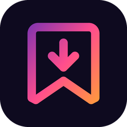
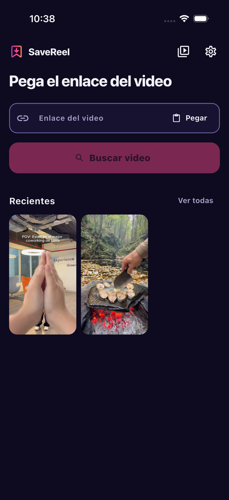
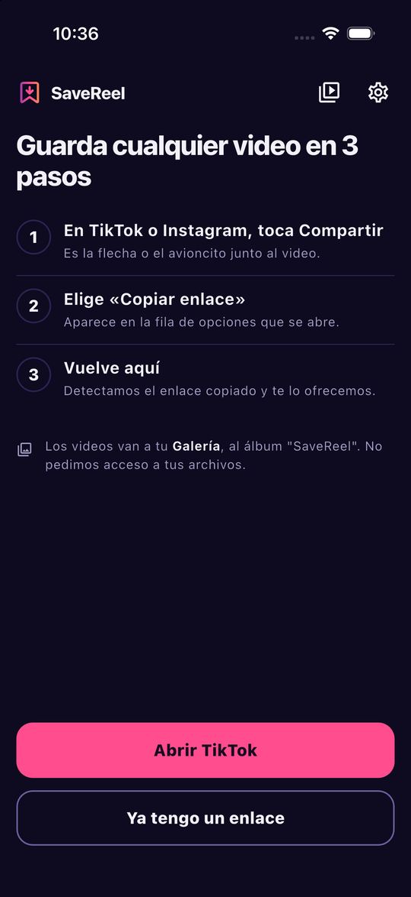
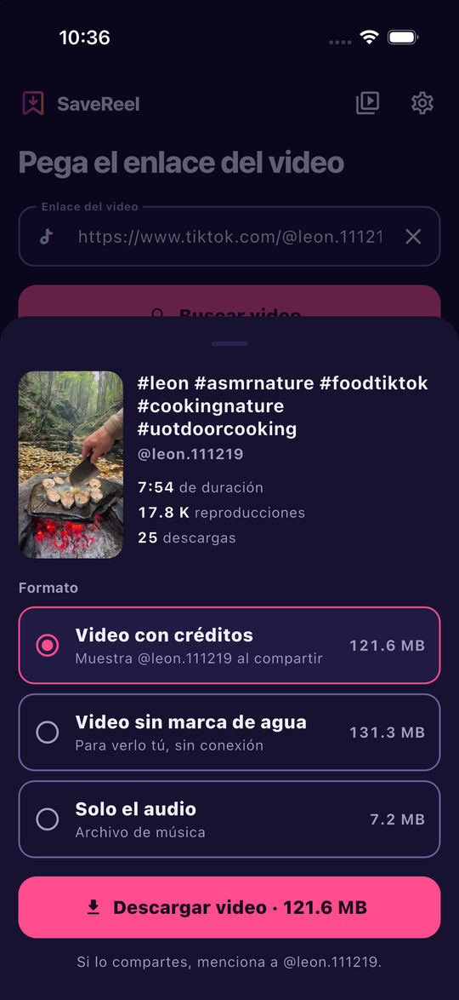
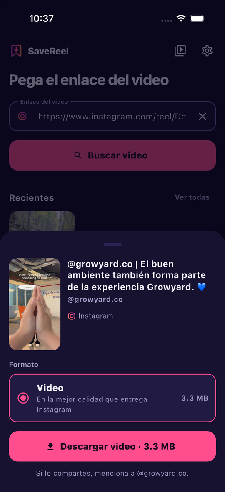
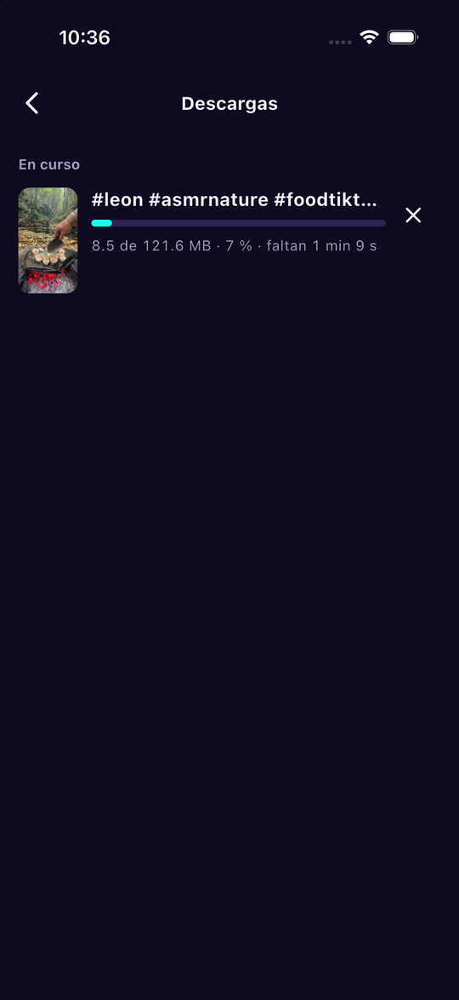
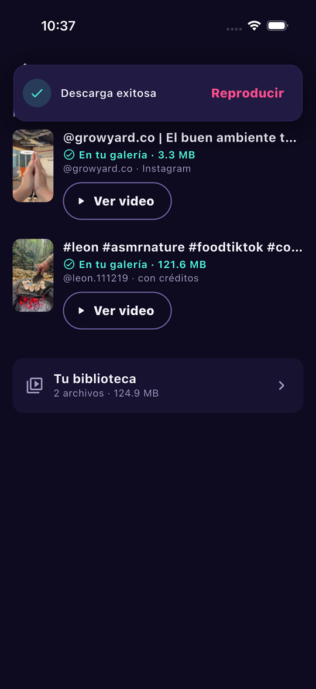
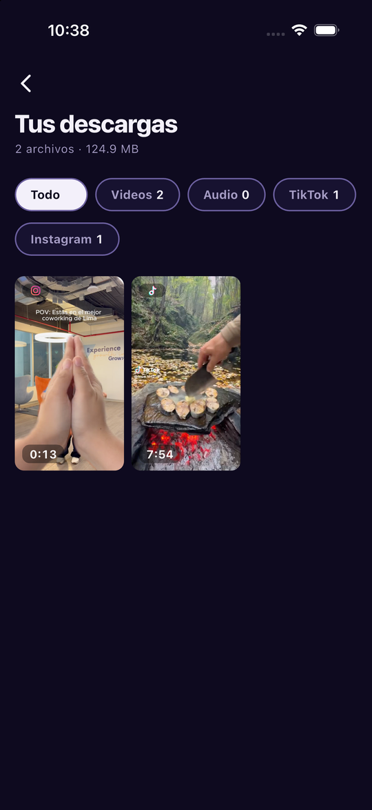
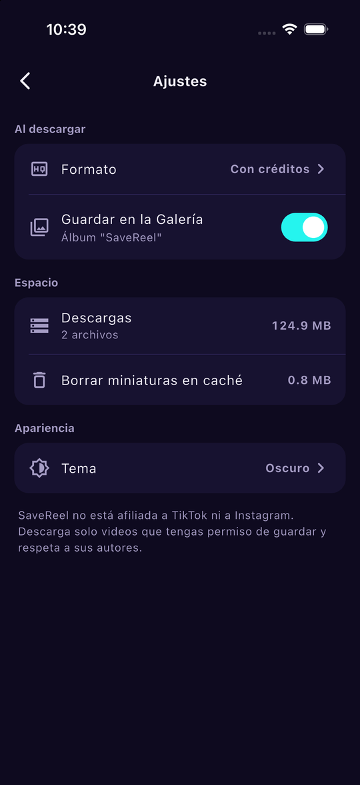

<p align="center">
  
</p>

<h1 align="center">SaveReel</h1>

<p align="center"><b>Guarda videos de TikTok e Instagram en tu teléfono, con solo su enlace.</b></p>

<table align="center">
  <tr>
    <td align="center"><b>TikTok</b><br><sub>Con créditos, sin marca de agua<br>o solo el audio.</sub></td>
    <td align="center"><b>Instagram</b><br><sub>Reels, publicaciones e IGTV<br>públicos, sin iniciar sesión.</sub></td>
  </tr>
</table>

<p align="center">
  <a href="https://github.com/VMichael1999/SaveTic/actions/workflows/ci.yml"></a>
  
  
  
  
  <br>
  
  
  
  
</p>

Pega un enlace, mira el video y elige cómo guardarlo: queda en tu galería, en un álbum
propio, y se puede volver a ver sin conexión. Desde TikTok o Instagram basta con tocar
**Compartir** y elegir SaveReel: la app se abre con el enlace ya puesto, busca el video y
muestra los formatos. SaveReel no está afiliada a TikTok ni a Instagram: descarga solo
videos que tengas permiso de guardar y respeta a sus autores.

## Estado

La app está **completa y probada de punta a punta** en un iPhone 15, en el simulador de
iPhone y en un emulador de Android: pegar o compartir un enlace de TikTok o Instagram,
descargar, ver el progreso, guardar en la galería y volver a verlo desde la biblioteca.
Todavía **no está publicada** en las tiendas.

| Parte | Estado |
| --- | --- |
| Pantallas: inicio, primer uso, vista previa, descargas, biblioteca, reproductor, ajustes | Hecho, con pruebas |
| Sistema visual: tokens, paleta fusión TikTok + Instagram, tema claro y oscuro, avisos propios | Hecho |
| Descargas de TikTok | Hecho; usa el servicio de terceros [tikwm.com](https://www.tikwm.com) |
| Descargas de Instagram (reels, `/p/` e IGTV) | Hecho; usa la página pública de inserción, una fuente no oficial |
| Slideshows de TikTok y carruseles o fotos de Instagram | Hecho con pruebas; **el formato de las fuentes está supuesto y falta verificarlo con publicaciones reales** |
| Compartir desde otras apps (extensión en iOS, intent en Android) | Hecho |
| Biblioteca con filtros por red, tipo y audio, búsqueda, orden y selección múltiple | Hecho con pruebas |
| Atajos del sistema: «Guardar enlace copiado» | Android: atajo del ícono y mosaico de Ajustes rápidos, probados en emulador. iOS: acción de Atajos y Siri, probada solo en simulador (compila y se registra); falta verla en un iPhone real |
| Descarga en segundo plano | **Android:** servicio en primer plano con notificación de progreso, probado en emulador. **iOS:** tiempo extra y reanudación automática al volver, sin verificar en un iPhone real |
| Reanudar descargas cortadas y cuidar los datos móviles | Hecho con pruebas; la detección de la red usa código nativo y no se probó en un teléfono con datos móviles |
| Servidor propio que reemplace a los servicios de terceros | Pendiente |
| Publicar en App Store y Google Play | Pendiente (nombre, cuenta de Apple de pago y política de privacidad) |
| Reemplazar `video_thumbnail`, que está abandonado | Pendiente |

## Métricas

Medidas el 14 de octubre de 2026 sobre el proyecto completo.

| Métrica | Valor |
| --- | --- |
| Pruebas | **167** en 25 archivos |
| Cobertura de líneas | **78,5 %** (`core` 84 %, `presentation` 82 %, `config` 72 %, `data` 72 %, `domain` 69 %) |
| Código Dart | 7 051 líneas en `lib` (102 archivos) y 3 139 en pruebas, sin líneas en blanco |
| Pantallas | **7** (inicio, primer uso, vista previa, descargas, biblioteca, reproductor y ajustes) |
| Redes compatibles | **2** (TikTok e Instagram) |
| Versiones | Flutter 3.47.5 (estable), Dart 3.13, iOS 15 o superior, Android con Gradle 8.14 |

La cobertura cuenta las líneas ejecutables que cargan las pruebas. No se prueban de forma
automática la descarga real de archivos, la galería ni la extensión de Compartir (dependen
del dispositivo); esos caminos se verifican a mano. Los valores de las insignias son
fijos: hay que actualizarlos a mano al volver a medir.

```bash
flutter test --coverage
```

## Capturas

Tomadas en el simulador de iPhone 17 Pro con videos públicos reales, en el tema oscuro, que
es el que trae la app por defecto.

<table>
<tr><td align="center"><br><sub>Inicio</sub></td><td align="center"><br><sub>Primer uso</sub></td><td align="center"><br><sub>Vista previa, TikTok</sub></td><td align="center"><br><sub>Vista previa, Instagram</sub></td></tr>
<tr><td align="center"><br><sub>Descargando</sub></td><td align="center"><br><sub>Aviso de éxito</sub></td><td align="center"><br><sub>Biblioteca por red</sub></td><td align="center"><br><sub>Ajustes</sub></td></tr>
</table>

## Cómo correrla

Usa **Flutter 3.47.5** (ver `.fvmrc`). Con [fvm](https://fvm.app):

```bash
fvm use 3.47.5
fvm flutter pub get
fvm flutter run
```

Las versiones anteriores de Flutter no compilan para iOS con Xcode 26 o 27: su herramienta
llama a `lipo -verify_arch` con una sintaxis que ese Xcode ya no acepta.

Para ver el catálogo de componentes (botones, avisos, hojas, colores) sin recorrer la app:

```bash
fvm flutter run --dart-define=CATALOG=true
```

### En un iPhone real

Hay que elegir tu equipo de desarrollo en Xcode (*Signing & Capabilities*) tanto en `Runner`
como en `ShareExtension`. Con una cuenta de Apple gratuita la app caduca a los 7 días y hay
que volver a instalarla.

```bash
fvm flutter run --release -d <id-del-iphone>
```

## Recibir enlaces desde «Compartir»

SaveReel aparece en la hoja de Compartir de las demás apps (por ejemplo TikTok o Instagram).
Al elegirla, la app se abre con el enlace ya puesto, busca el video y muestra los formatos.

- **Android:** `MainActivity.kt` recibe el texto compartido (`ACTION_SEND`) y se lo pasa a
  Flutter por el canal `savetic/share`. Se prueba con
  `adb shell am start -a android.intent.action.SEND -t text/plain --es android.intent.extra.TEXT "https://vm.tiktok.com/ZMh7K2pQx/" -n com.michaeldevtool.savetic/.MainActivity`.
- **iPhone:** la extensión `ios/ShareExtension` recibe el enlace y abre `savetic://share?text=…`.
  No usa grupos de app, así que funciona con una cuenta de desarrollo gratuita.
- En TikTok e Instagram, el menú propio de Compartir no siempre lista SaveReel: hay que
  tocar «Más» o «…» para abrir la hoja del sistema, donde sí aparece.

Para probarlo sin salir de la terminal, en el simulador de iPhone:

```bash
xcrun simctl openurl booted 'savetic://share?text=https%3A%2F%2Fvm.tiktok.com%2FZMh7K2pQx%2F'
```

## Instagram

Los enlaces `instagram.com/reel/…`, `/p/…` y `/tv/…` se resuelven con la página pública de
inserción de Instagram, que no pide clave ni sesión. Es una fuente no oficial: puede dejar de
funcionar si Instagram la cambia. Como respaldo se puede apuntar a una instancia de
[Cobalt](https://github.com/imputnet/cobalt) con `--dart-define=COBALT_URL=https://…` (y
`--dart-define=COBALT_KEY=…` si pide clave). Solo funciona con contenido público.

### Buscar, ordenar y seleccionar en la biblioteca

- **Buscar:** la lupa filtra por título o autor mientras se escribe, sin distinguir mayúsculas ni
  tildes («cancion» encuentra «Canción») y exigiendo todas las palabras. Se combina con los
  filtros de tipo y de red.
- **Ordenar:** más nuevos (por omisión), más antiguos, más pesados o por título; los que no
  tienen título van al final.
- **Seleccionar varios:** el botón de la barra, o *mantener pulsada una miniatura → Seleccionar*,
  activa el modo selección. Tocar marca o desmarca; la barra de abajo comparte, copia a la
  galería o elimina (con confirmación) todo lo elegido. Las galerías aportan todas sus piezas, y
  el botón atrás sale de la selección sin cerrar la pantalla.

- **Favoritos:** *mantener pulsada una miniatura → Agregar a favoritos* pone un corazón en la
  miniatura y activa el filtro **Favoritos**, que solo aparece cuando hay alguno. La marca se
  guarda junto al archivo y sobrevive a volver a descargarlo.

### Atajos del sistema

Todos abren `savetic://clipboard`: la app lee el portapapeles, saca el enlace de TikTok o de
Instagram que haya dentro (aunque venga con más texto), lo busca y muestra los formatos, igual
que al compartir. Si no hay ningún enlace copiado, lo explica en lugar de abrirse sin decir nada.

- **Android:** al mantener pulsado el ícono aparece *Guardar el enlace copiado*
  (`res/xml/shortcuts.xml`). Además hay un mosaico para los Ajustes rápidos, *Guardar enlace*
  (`SaveLinkTileService`); el usuario lo agrega desde el editor de Ajustes rápidos.
- **iPhone:** la acción *Guardar enlace copiado* (`ios/Runner/SaveLinkIntent.swift`, App Intents,
  iOS 16 o más) aparece sola en la app Atajos y se puede usar por voz con frases como «Guardar
  enlace copiado en SaveReel». iOS pide permiso de pegado la primera vez que la app lee el
  portapapeles. Las frases de Siri están en español.
- En Android 10 o más el portapapeles solo se puede leer con la app en primer plano, por eso la
  lectura reintenta unos instantes hasta que la app tiene el foco.
- Flutter toma por defecto la dirección de un enlace como ruta de pantalla (`/clipboard`), que la
  app no conoce; por eso `flutter_deeplinking_enabled` está apagado en el manifiesto y las rutas
  desconocidas vuelven al arranque.

### Fotos, slideshows y carruseles

Las publicaciones con varias piezas (un slideshow de TikTok, un carrusel de Instagram o una
foto suelta) se bajan completas a una carpeta, con un solo avance general, y cada pieza va
también a la galería del teléfono. En la biblioteca aparecen como **un solo elemento**, con la
primera foto de portada y la cantidad de piezas, y se abren en un visor para deslizar entre
ellas, ampliar las fotos (pellizco o doble toque), compartir, guardar en la galería y eliminar.

Los lectores de las fuentes (`images` en el servicio de TikTok y `edge_sidecar_to_children` en
la página de inserción de Instagram) se escribieron a partir del formato conocido y se prueban
con páginas de ejemplo: si alguna publicación real no se reconoce, hay que ajustar
`video_data_model.dart` o `instagram_embed_parser.dart`.

### Descargas en segundo plano

- **Android:** al empezar una descarga se levanta un servicio en primer plano (`DownloadService`,
  tipo `dataSync`) con una notificación de progreso. Así el sistema no cierra la app al pasar a
  segundo plano y la descarga sigue hasta el final; al terminar, una notificación avisa
  «Descarga lista» (o el fallo). Pide el permiso de notificaciones de Android 13 una vez.
- **iOS:** el sistema suspende la app a los ~30 s de salir de pantalla y no deja seguir
  ejecutando código. SaveReel pide ese tiempo extra (`beginBackgroundTask`) y, si la conexión se
  corta por la suspensión, retoma sola la descarga desde donde quedó al volver (hasta 3 veces,
  gracias al `.part`). Al terminar con la app fuera de pantalla manda una notificación local.
  Una descarga larga que siga con el teléfono bloqueado exigiría un `URLSession` en segundo plano
  con código nativo propio; no está hecho.
- Los textos de las notificaciones salen de Flutter, no del código nativo.

### Descargas cortadas y datos móviles

Si una descarga se corta (se va la señal, se cierra la app), lo bajado queda en un archivo
`.part` y, al reintentar, SaveReel pide al servidor solo lo que falta (cabecera `Range`; TikTok e
Instagram la aceptan). Una galería retoma pieza por pieza. Lo que nadie retoma en 3 días se
borra solo, porque los enlaces caducan.

En **Ajustes → Datos móviles** se elige qué hacer cuando la red es de pago (datos móviles,
punto de acceso o ahorro de datos): *Preguntar si pesa mucho* (50 MB o más, por omisión),
*Solo con Wi-Fi* (pregunta siempre) o *Descargar siempre*. La red se consulta con código nativo
(`ConnectivityManager` en Android y `NWPathMonitor` en iOS), sin paquetes extra.

### Idiomas

La app está en español e inglés y cambia al momento desde **Ajustes → Idioma**, sin reiniciar.
La primera vez usa el idioma del teléfono si lo tiene; si no, español.

- Los textos viven en `localization/<idioma>.json`, un archivo por idioma.
- `dart run localization/generator.dart` los revisa (mismas claves y mismos `{datos}` en todos
  los idiomas) y genera `lib/src/localization/translations.g.dart`. Las pruebas fallan si ese
  archivo no está al día.
- En el código se usan con `context.strings.algo`; al cambiar de idioma, `LocaleCubit` emite
  el nuevo `Locale` y el `MaterialApp` reconstruye toda la app. No usa GetX ni paquetes de
  traducción.
- Para añadir un idioma: crea su JSON, agrégalo en `AppLanguages` (`app_texts.dart`) y corre
  el generador.

Quedan en español los textos que fija el sistema: las frases de Siri del atajo de iOS y los
permisos de `Info.plist`.

## Servicio de descargas

Para TikTok, por omisión se consulta el servicio público de
[tikwm.com](https://www.tikwm.com), que no pide clave. La URL del servicio se cambia al
compilar, sin tocar el código:

| Opción | Para qué |
|---|---|
| `--dart-define=API_BASE_URL=https://mi-backend.com` | Usar un backend propio o un servidor de prueba. |
| `--dart-define=API_ENDPOINT=/analysis` | Ruta del servicio (por omisión `/api/`). |
| `--dart-define-from-file=env.json` | Pasar `RAPIDAPI_KEY` si usas un servicio de RapidAPI (copia `env.example.json`; `env.json` no se sube a git). |

Las cabeceras de RapidAPI solo se envían cuando hay `RAPIDAPI_KEY`. Los archivos de video se
bajan con un cliente aparte que nunca recibe ninguna clave.

**Antes de publicar en las tiendas** conviene un backend propio: los servicios públicos de
terceros no tienen garantías y pueden cambiar o limitar el acceso.

## Cómo está organizada

Arquitectura limpia con `flutter_bloc` y `get_it`:

```text
lib/src/
├── localization/  textos por idioma (generados desde `localization/*.json`)
├── config/        tema (colores, texto, tokens de tamaño y movimiento) y rutas
├── core/          enlaces, errores, red, almacenamiento y widgets comunes
└── features/
    └── tiktok_downloader/
        ├── data/          fuentes de TikTok e Instagram, biblioteca en disco
        ├── domain/        entidades, repositorios y casos de uso
        └── presentation/  bloques, pantallas y widgets
```

Los colores y las medidas salen de `SaveticColors` y de los tokens de `app_tokens.dart`;
los widgets no usan valores sueltos.

## Pruebas

```bash
flutter analyze
flutter test
```

## Contribuir

Lee [CONTRIBUTING.md](CONTRIBUTING.md). Las ideas y los errores se reportan en los issues.

## Licencia

[MIT](LICENSE)
